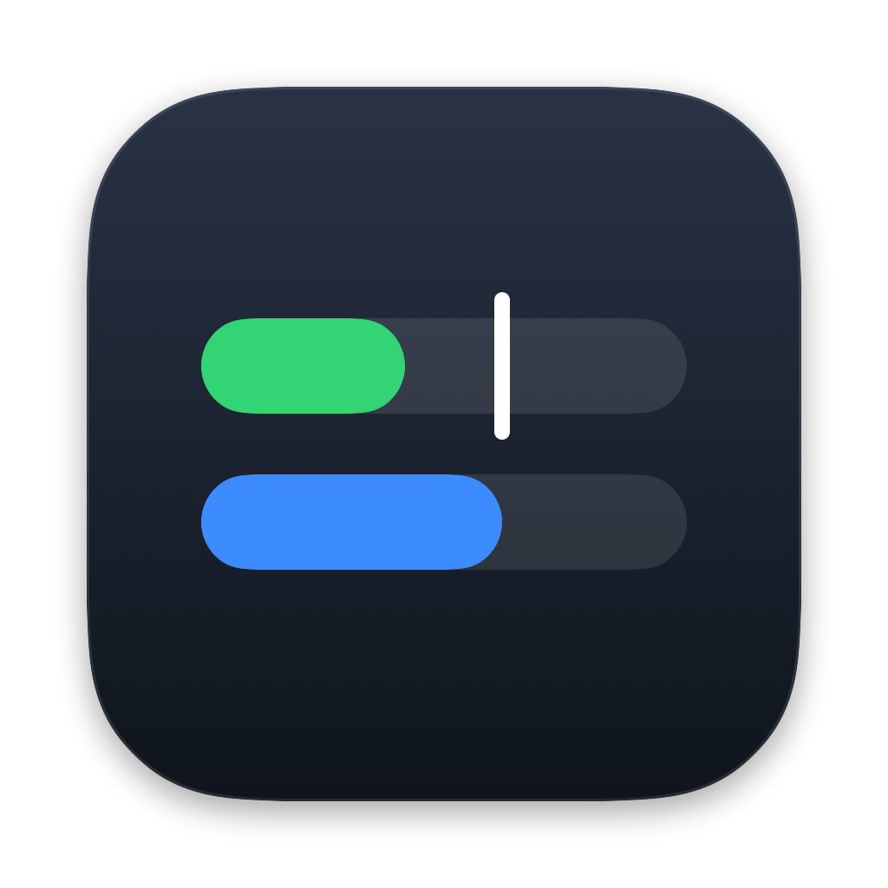
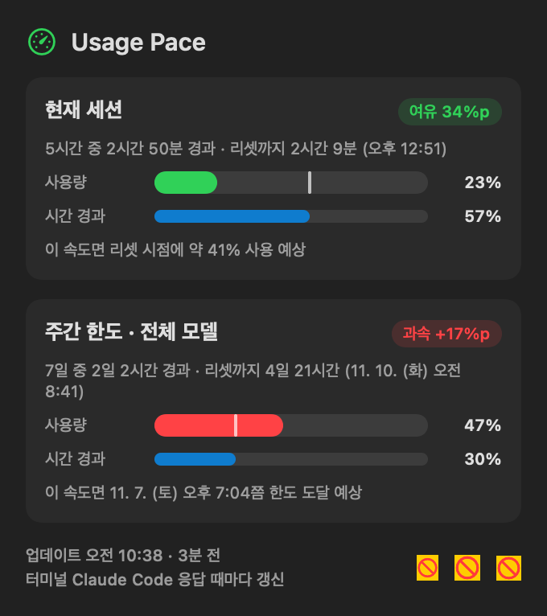

<p align="center">
  
</p>

<h1 align="center">Usage Pace</h1>

<p align="center">
  Claude Code 사용량을 <b>한도 기간 중 시간이 얼마나 지났는지</b>와 나란히 보여주는 macOS 메뉴바 앱.<br>
  지금 너무 빨리 쓰고 있는지 한눈에 알 수 있어요.
</p>

<p align="center">
  <a href="README.md">English</a>
</p>

<p align="center">
  
</p>

## 왜 필요한가요

보통 사용량은 "47% 사용"처럼만 보여줘요. 그런데 그 숫자만으로는 괜찮은지 알 수 없어요.
일주일 중 30%밖에 안 지났는데 47%를 썼다면 너무 빠른 거고, 80%가 지났다면 넉넉한 거예요.

Usage Pace는 이 두 숫자를 나란히 보여줘요.

## 기능

- 5시간 세션과 주간 한도 각각 **사용 % vs 시간 경과 %**
- **기준선**: 사용량 막대 위의 흰 선이 일정한 속도로 썼을 때의 위치예요.
- **페이스 배지**: `여유` / `적정 페이스` / `빠름` / `과속`
- **예측**: "이 속도면 리셋 시점에 약 76% 사용" 또는 "토 오후 6:37쯤 한도 도달"
- **메뉴바 표시**: `47% / 30%` 형태. 주간/세션과 표시 방식을 고를 수 있어요.
- **9개 언어**
- **로그인·토큰·네트워크 접속 없음**

## 동작 방식

Claude Code는 [상태 표시줄(status line)](https://code.claude.com/docs/en/statusline) 명령에 공식 사용량 데이터
(`rate_limits.five_hour` / `seven_day`)를 넘겨줘요. Usage Pace는 이 숫자만 사용해요.

1. **연결하기**를 누르면 `~/.claude/settings.json`의 `statusLine`이 작은 도우미 프로그램으로 설정돼요.
   - 바꾸기 전에 `settings.json.usagepace-backup`으로 백업해요.
   - 기존 상태 표시줄이 있으면 도우미가 그것도 함께 실행해서 그대로 유지돼요.
2. Claude Code가 응답할 때마다 도우미가 숫자를 `~/Library/Application Support/UsagePace/rate_limits.json`에 저장하고, 앱이 이 파일을 읽어요.
3. **연결 해제**를 누르면 원래 상태 표시줄로 돌아가요.

### 한계

- **터미널 Claude Code**와 **Pro·Max·Ultra 플랜**이 필요해요. 사용량 데이터는 이 플랜에만 제공돼요.
- 사용량 숫자는 **터미널 Claude Code가 응답할 때만** 갱신돼요. 데스크톱 앱이나 claude.ai에서 쓴 양은 다음 터미널 응답 때 반영돼요.
  시간 경과 %는 항상 실시간이고, 데이터가 1시간 넘게 오래되면 앱이 알려줘요.
- 상태 표시줄을 설정하면 터미널 Claude Code 하단의 일부 단축키 안내(`? for shortcuts` 등)가 숨겨져요.

## 설치

macOS 13 Ventura 이상, Apple Silicon과 Intel 모두 지원해요.

1. [Releases](../../releases)에서 `UsagePace-<버전>.zip`을 내려받아 압축을 풀고 `UsagePace.app`을 **응용 프로그램** 폴더로 옮겨요.
2. 아직 Apple 공증을 받지 않아서 처음 실행할 때 macOS가 막아요.
   앱을 한 번 연 뒤 **시스템 설정 → 개인정보 보호 및 보안**에서 **그래도 열기**를 누르세요.
   또는 터미널에서 아래 명령을 실행해도 돼요:
   ```bash
   xattr -dr com.apple.quarantine /Applications/UsagePace.app
   ```
3. 메뉴바 아이콘을 누르고 **연결하기**를 눌러요.
4. 터미널 Claude Code에서 아무 메시지나 보내면 몇 초 안에 사용량이 나타나요.

## 삭제

1. **설정(⚙︎) → 연결 해제**를 눌러요. 원래 상태 표시줄로 돌아가요.
2. 앱을 종료하고 `UsagePace.app`을 지워요.
3. `~/Library/Application Support/UsagePace` 폴더를 지워요.

## 직접 빌드

Xcode 없이 Command Line Tools만 있으면 돼요.

```bash
./build.sh                       # → ~/Applications/UsagePace.app (Apple Silicon + Intel 범용)
open ~/Applications/UsagePace.app
```

- **번역**: `tools/translations.py`가 원본이에요. 고친 뒤 `python3 tools/translations.py Resources`를 실행하면 `Resources/<언어>.lproj/Localizable.strings`가 다시 만들어져요.
  - 언어를 추가하려면 translations.py에 열을 추가하고, `Sources/L10n.swift`의 `AppLanguage`에 case를 추가해요.
- **아이콘**: `tools/make_icon.swift`를 고친 뒤 `./tools/make_icon.sh`를 실행하면 `Assets/AppIcon.icns`가 만들어져요.
- **명령줄**: `UsagePace.app/Contents/MacOS/UsagePace --connect | --disconnect | --status`
- **테스트 환경 변수**: `USAGEPACE_DIR`, `USAGEPACE_CLAUDE_DIR`로 실제 `~/.claude` 대신 임시 폴더를 쓸 수 있어요.
- **화면 미리보기**: `SNAPSHOT_LANG=ko UsagePace --snapshot out.png`

### 계산 방식

- 창 시작 = 리셋 시각 − 창 길이(5시간 또는 7일)
- 시간 경과율 = (지금 − 창 시작) ÷ 창 길이
- 예측 사용률 = 현재 사용률 ÷ 시간 경과율

## 개인정보

네트워크 요청을 전혀 하지 않고, 분석 데이터도 수집하지 않아요.
Claude Code가 상태 표시줄에 넘겨주는 사용량 숫자만 읽어요.

## 안내

Usage Pace는 독립 프로젝트로, Anthropic과 제휴하거나 승인받지 않았어요.
Claude와 Claude Code는 Anthropic, PBC의 상표예요.

## 라이선스

[MIT](LICENSE)
