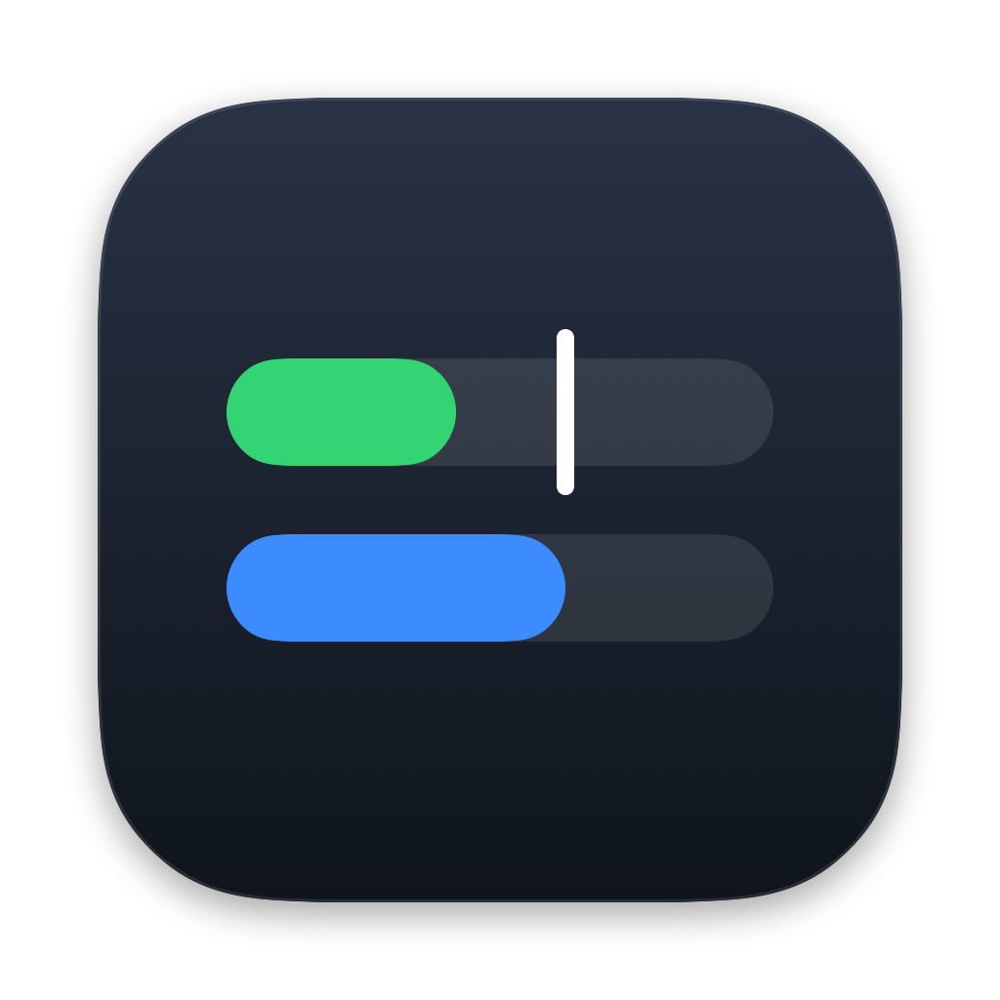
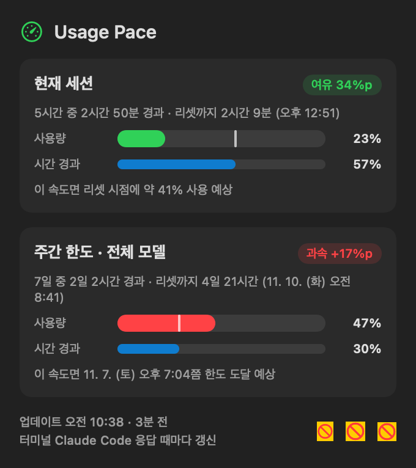

<p align="center">
  
</p>

<h1 align="center">Usage Pace</h1>

<p align="center">
  A macOS menu bar app that shows your Claude Code usage <b>next to how much of the limit window has already passed</b>,<br>
  so you can tell at a glance whether you're on pace.
</p>

<p align="center">
  <a href="README.ko.md">한국어</a>
</p>

<p align="center">
  
</p>

## Why

Plan limits tell you "47% used", but that number alone doesn't say whether you're fine.
If only 30% of the week has passed and you've already used 47%, you're going too fast.
If 80% of the week has passed, 47% means you have plenty left.

Usage Pace puts both numbers side by side.

## Features

- **Used % vs time elapsed %** for the 5-hour session and the weekly window
- **Pace marker**: a white line on the usage bar shows where you'd be at an even pace.
- **Pace badge**: shows whether you have room to spare, are on pace, are going fast, or are going too fast.
- **Projection**: "about 76% used by reset" or "you'll hit the limit around Sat 6:37 PM"
- **Menu bar text** such as `47% / 30%`. You can choose weekly or session, and how it's shown.
- **9 languages**: English, 한국어, 日本語, 简体中文, 繁體中文, Español, Français, Deutsch, Português (Brasil)
- **No login, no tokens, no network access**

## How it works

Claude Code passes official rate limit data (`rate_limits.five_hour` / `seven_day`) to its
[status line](https://code.claude.com/docs/en/statusline) command. Usage Pace reads only those numbers.

1. When you click **Connect**, the app sets a small helper as `statusLine` in `~/.claude/settings.json`.
   - Before changing anything, it backs up the file to `settings.json.usagepace-backup`.
   - If you already had a status line, the helper runs it too, so your status line keeps working.
2. Each time Claude Code responds, the helper saves the numbers to
   `~/Library/Application Support/UsagePace/rate_limits.json`. The menu bar app reads that file.
3. **Disconnect** restores your original status line.

### Limitations

- Requires **Claude Code in the terminal** with a **Pro, Max or Ultra** plan.
  Claude Code only includes `rate_limits` for these plans.
- Usage numbers update **only when Claude Code responds in the terminal**. Usage in the desktop app
  or on claude.ai shows up on the next terminal response. The time-elapsed % always stays current.
  If data is more than an hour old, the app says so.
- With a custom status line set, Claude Code's terminal UI hides some footer hints (for example `? for shortcuts`).

## Install

Requires macOS 13 Ventura or later, on Apple Silicon or Intel.

1. Download `UsagePace-<version>.zip` from [Releases](../../releases), unzip it, and move `UsagePace.app` to **Applications**.
2. Usage Pace isn't notarized by Apple yet, so macOS blocks the first launch.
   Open the app once, then go to **System Settings → Privacy & Security** and click **Open Anyway**.
   Or run this in Terminal:
   ```bash
   xattr -dr com.apple.quarantine /Applications/UsagePace.app
   ```
3. Click the menu bar icon, then **Connect**.
4. Send any message to Claude Code in your terminal. Your usage appears within a few seconds.

## Uninstall

1. Click **Settings (⚙︎) → Disconnect**. This restores your original status line.
2. Quit the app and delete `UsagePace.app`.
3. Delete `~/Library/Application Support/UsagePace`.

## Build from source

Xcode isn't required; the Command Line Tools are enough.

```bash
./build.sh                       # → ~/Applications/UsagePace.app (universal: Apple Silicon + Intel)
open ~/Applications/UsagePace.app
```

- Translations: edit `tools/translations.py`, then run `python3 tools/translations.py Resources`
- Icon: edit `tools/make_icon.swift`, then run `./tools/make_icon.sh`
- CLI: `UsagePace.app/Contents/MacOS/UsagePace --connect | --disconnect | --status`

## Privacy

Usage Pace makes no network requests and collects no analytics.
It reads only the rate limit numbers that Claude Code passes to its status line.

## Disclaimer

Usage Pace is an independent project. It is not affiliated with or endorsed by Anthropic.
Claude and Claude Code are trademarks of Anthropic, PBC.

## License

[MIT](LICENSE)
